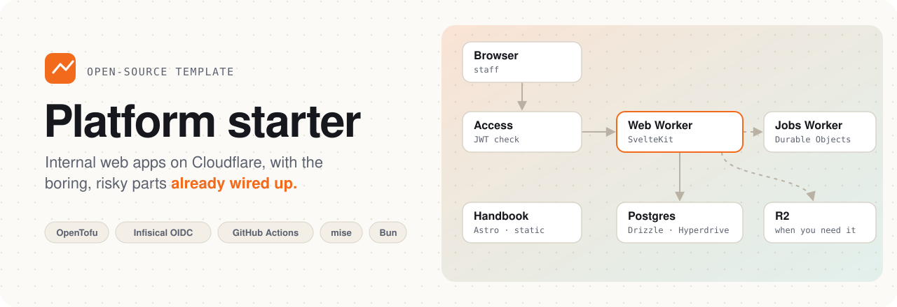
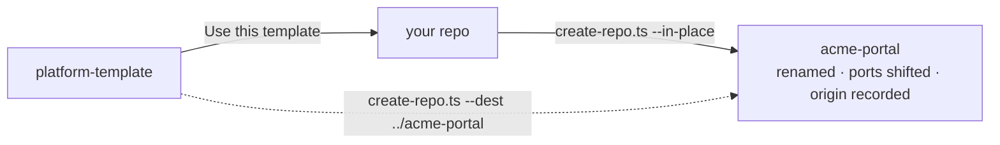
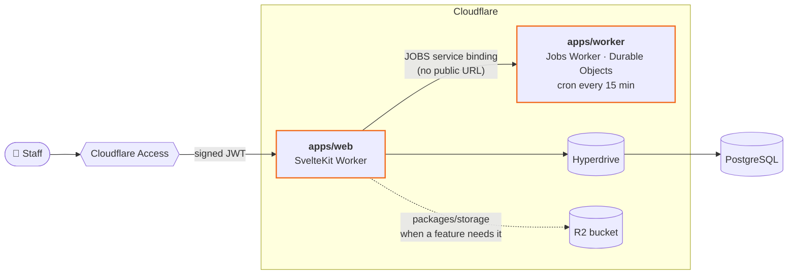
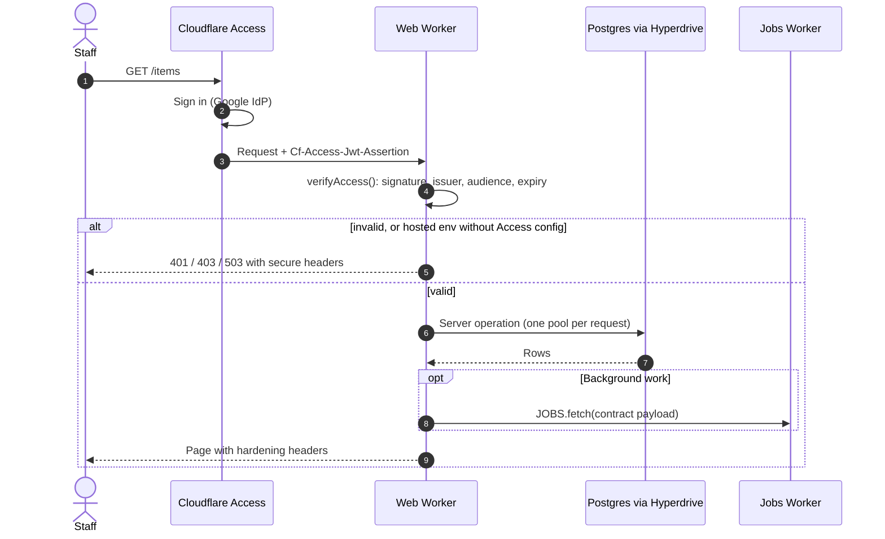
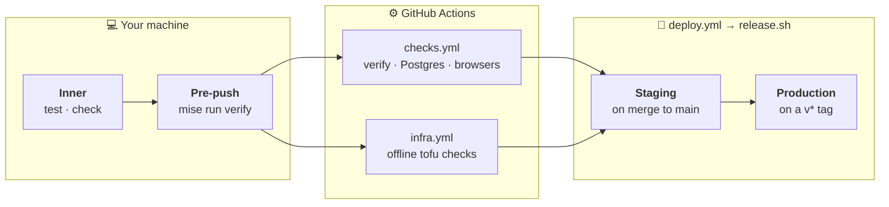
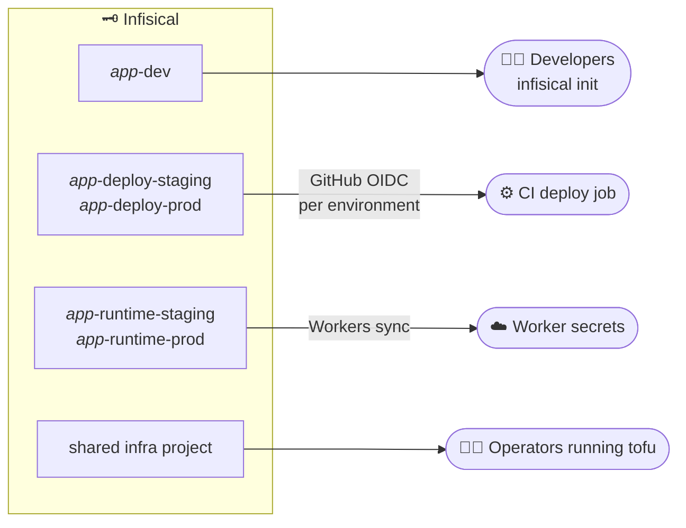

<!-- template-only:start -->

<p align="center">
  <picture>
    <source media="(prefers-color-scheme: dark)" srcset=".github/assets/banner-dark.svg">
    
  </picture>
</p>

<p align="center">
  <a href="https://github.com/austindelic/platform-template/actions/workflows/checks.yml"></a>
  <a href="LICENSE"></a>
  
  
  
  
  
</p>

<p align="center">
  <a href="#create-your-project"><b>Create your project</b></a> ·
  <a href="#start-locally">Start locally</a> ·
  <a href="#architecture">Architecture</a> ·
  <a href="#from-laptop-to-production">Release flow</a> ·
  <a href="#secrets">Secrets</a> ·
  <a href="#opt-in-features">Opt-in features</a>
</p>

<!-- template-only:end -->

# Platform starter

A starter for internal web apps on Cloudflare. The parts that usually take a week and go wrong quietly are already done and tested: staff sign-in through Cloudflare Access, a private background Worker, migrations, encrypted infrastructure state, secrets that CI reads without storing anything in GitHub, and a release that checks itself. There's no product code, credentials or account IDs, just one small example feature showing where your code goes.

|                              | What you get                                                                                                                |
| ---------------------------- | --------------------------------------------------------------------------------------------------------------------------- |
| 🔐 **Locked down**           | Every request is checked against Cloudflare Access except `/healthz`. Hosted environments without Access config fail closed |
| 🧱 **Clear borders**         | Apps import packages, never each other. Routes stay thin, and the database and storage live behind adapters                 |
| 🔁 **Same loops everywhere** | `mise run verify` on your laptop is what CI runs. Every tool version is pinned                                              |
| 🚀 **Safe releases**         | `main` deploys staging, a `v*` tag deploys production. Migrations run first, then a `/healthz` probe and an Access check    |
| 🗝️ **No secrets in GitHub**  | CI signs in to Infisical over OIDC. Opt-in key minting gives every token an expiry                                          |
| 🤖 **Agent-ready**           | [AGENTS.md](AGENTS.md) rules, pinned agent tools and vendored skills, so coding agents follow the same loops you do         |

<!-- template-only:start -->

## Create your project

1. Click **Use this template** on GitHub and clone your new repo, or clone this one. Install [mise](https://mise.jdx.dev), then run `mise trust && mise install` and `mise exec -- bun install`.
2. Rename it and move its local ports so it can run beside other projects:

   ```bash
   mise exec -- bun scripts/create-repo.ts --slug acme-portal --in-place --dry-run
   ```

   Check the ports it prints, then run it again without `--dry-run`. Pass `--runner blacksmith` if your org runs CI on Blacksmith.

3. Review the result with `git diff`, put your own people or teams in `.github/CODEOWNERS`, and commit.



The script renames the identifiers listed in `template.json` (package names, Worker names, database and bucket names, titles). It shifts all six local ports by the first offset that's free on your machine and unused by sibling repos, and records the template commit in `.template-origin.json`. It never pushes or touches cloud accounts, and it exits non-zero if anything was missed. It also removes this section, `template.json`, itself and the template's contributor docs from your project. Run it with `--help` for every option.

<!-- template-only:end -->

## Start locally

You need [mise](https://mise.jdx.dev) and Docker with Compose v2.

```bash
mise trust && mise install && mise exec -- bun install
mise run infra:up     # Postgres and RustFS (S3-compatible), plus the local bucket
mise run db:migrate
mise run dev          # web app, jobs Worker and handbook together
```

| Service                  | Local address                                        |
| ------------------------ | ---------------------------------------------------- |
| Web app (SvelteKit)      | [http://127.0.0.1:5177](http://127.0.0.1:5177)       |
| Handbook (Astro)         | [http://127.0.0.1:4323](http://127.0.0.1:4323)       |
| Jobs Worker (private)    | `127.0.0.1:8789`, reached through the `JOBS` binding |
| PostgreSQL               | `127.0.0.1:55432`                                    |
| Object storage / console | `127.0.0.1:59000` / `127.0.0.1:59001`                |

**Secrets are optional locally.** Run `mise exec -- infisical login` and `mise exec -- infisical init`, then pick this project's `<app>-dev` Infisical project (one environment, slug `main`). Without one, the apps use local defaults and any ignored `.dev.vars` files.

The example **Items** page follows the whole path once: a SvelteKit route, a server operation, then the shared Drizzle schema. Copy that shape for your first feature.

## Architecture



| Path                                                                     | Owns                                                                                     |
| ------------------------------------------------------------------------ | ---------------------------------------------------------------------------------------- |
| [`apps/web`](apps/web)                                                   | HTTP routes and pages. Access check in `hooks.server.ts`, one database pool per request  |
| [`apps/worker`](apps/worker)                                             | Background work and cron: contracts, a coordinator Durable Object and bounded processors |
| [`apps/docs`](apps/docs)                                                 | The staff handbook (Astro Starlight)                                                     |
| [`packages/db`](packages/db)                                             | PostgreSQL schema, migrations and adapter (Drizzle)                                      |
| [`packages/storage`](packages/storage)                                   | S3-compatible adapter: R2 in the cloud, RustFS locally                                   |
| [`infra/local`](infra/local)                                             | Disposable local services (Docker Compose)                                               |
| [`infra/cloud`](infra/cloud)                                             | Cloudflare resources in OpenTofu with encrypted state in R2, plus the secrets model      |
| [`infra/secrets`](infra/secrets), [`infra/monitoring`](infra/monitoring) | Opt-in key minting, and Better Stack plus Sentry                                         |
| [`scripts`](scripts)                                                     | Operator tasks: release, secret push, hosted commands, backups                           |
| [`tests`](tests)                                                         | Integration, browser and config tests                                                    |

<details>
<summary><b>What happens on a request</b></summary>



`/healthz` skips all of this and answers a fixed `ok`, so uptime monitors never need a database, a secret or a login.

</details>

## From laptop to production

The same `mise run` tasks run on your laptop and in CI, so a green local run means a green CI run.



| Loop     | Command                           | Covers                                                                                               |
| -------- | --------------------------------- | ---------------------------------------------------------------------------------------------------- |
| Inner    | `mise run test`, `mise run check` | Unit and config tests (including the Wrangler binding guard), types                                  |
| Pre-push | `mise run verify`                 | Workflow lint, format, types, lint, tests, build and `wrangler deploy --dry-run`                     |
| Database | `mise run test:integration`       | Integration tests against a disposable Postgres                                                      |
| Browser  | `mise run test:e2e`               | Playwright at desktop and phone sizes: page errors, console errors, failed requests, sideways scroll |
| Infra    | `mise run infra:check`            | `tofu fmt`, `validate` and mocked `tofu test`, all offline                                           |

Every release runs migrations over a direct connection, then deploys the jobs Worker and then the web Worker. It fails on leftover `REPLACE_WITH_` placeholders, a missing migration URL, a `/healthz` that doesn't answer `ok`, or a host that isn't behind Access. Deploys stay off until you set the repository variable `DEPLOY_ENABLED` to `true`, and the `production` environment accepts only `v*` tags.

## Secrets

Infisical is the only secret store. Projects are split by who reads them, and nothing is stored in GitHub.



The OpenTofu state passphrase and recovery codes never go in Infisical: keep them in a password manager. The full model, including the OIDC subject format, is in [infra/cloud/README.md](infra/cloud/README.md).

## Going to the cloud

Follow [infra/cloud/README.md](infra/cloud/README.md) in order:

1. **State bucket.** One private R2 bucket for encrypted OpenTofu state.
2. **Apply.** `tofu apply` for `environments/staging` and `environments/production`. CI never applies.
3. **Infisical.** Create the projects and OIDC identities, and set `INFISICAL_IDENTITY_ID` and `INFISICAL_PROJECT_ID` on each GitHub environment.
4. **Wrangler.** Replace the `REPLACE_WITH_` IDs in each `wrangler.jsonc`.
5. **First deploy.** Set `DEPLOY_ENABLED=true` and merge to `main`.

## Opt-in features

Each ships switched off and inert until you turn it on. The recipes are in [infra/cloud/README.md](infra/cloud/README.md).

| Feature            | Turn on with                                     | What you get                                                                                                                                     |
| ------------------ | ------------------------------------------------ | ------------------------------------------------------------------------------------------------------------------------------------------------ |
| 🔑 **Key minting** | `manage_credentials`, then apply `infra/secrets` | Deploy tokens, R2 keys, app secrets and database roles with an expiry and a rotation schedule, written to Infisical without anyone handling them |
| 📈 **Monitoring**  | apply `infra/monitoring`                         | A Better Stack `/healthz` monitor, cron and backup heartbeats, and Sentry                                                                        |
| 💾 **Backups**     | `backups_enabled` and `BACKUPS_ENABLED`          | Nightly encrypted dumps to a locked R2 bucket, a copy in B2, and a weekly restore test                                                           |
| 📬 **Queues**      | `queues = ["jobs"]`                              | A queue and a dead-letter queue per key, with a guarded consumer                                                                                 |

## Adding a feature

```text
apps/web/src/lib/features/<feature>/   browser-safe models and components
apps/web/src/lib/server/<feature>/     server operations (the only code that touches the database)
apps/web/src/routes/<feature>/         thin routes
packages/db/                           schema and a generated migration
apps/worker/src/{contracts,processor}  only if the feature needs background work
```

Put tests next to the code they cover. A new Cloudflare binding goes in the top level and in both `env` blocks of each `wrangler.jsonc`, because Wrangler doesn't inherit them and `tests/config/wrangler.test.ts` fails until they match. [AGENTS.md](AGENTS.md) has the full rules.

## Before a real launch

- [ ] Add your authentication and access policy, beyond "can pass Access"
- [ ] Define your domain schema and replace the example Items feature
- [ ] Remove `apps/integration-gateway`, `packages/collaboration` and `packages/agent-client` if you don't need them
- [ ] Turn on monitoring and backups for production
- [ ] Set `.github/CODEOWNERS` and branch protection on `main`

## Licence

[MIT](LICENSE). The agent skills in `.agents/skills` are adapted from Context7's `find-docs` skill and Microsoft's `playwright-cli` skill and keep their upstream licences.

<!-- template-only:start -->

Want to improve the template? Read [CONTRIBUTING.md](CONTRIBUTING.md). To report a vulnerability, see [SECURITY.md](SECURITY.md).

<!-- template-only:end -->
